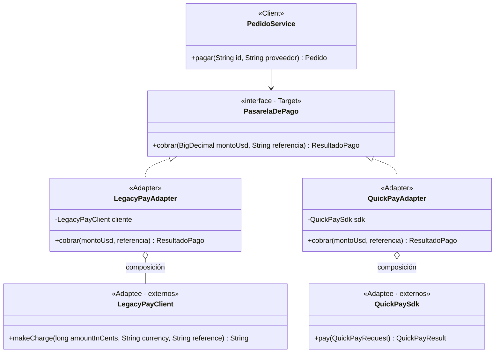
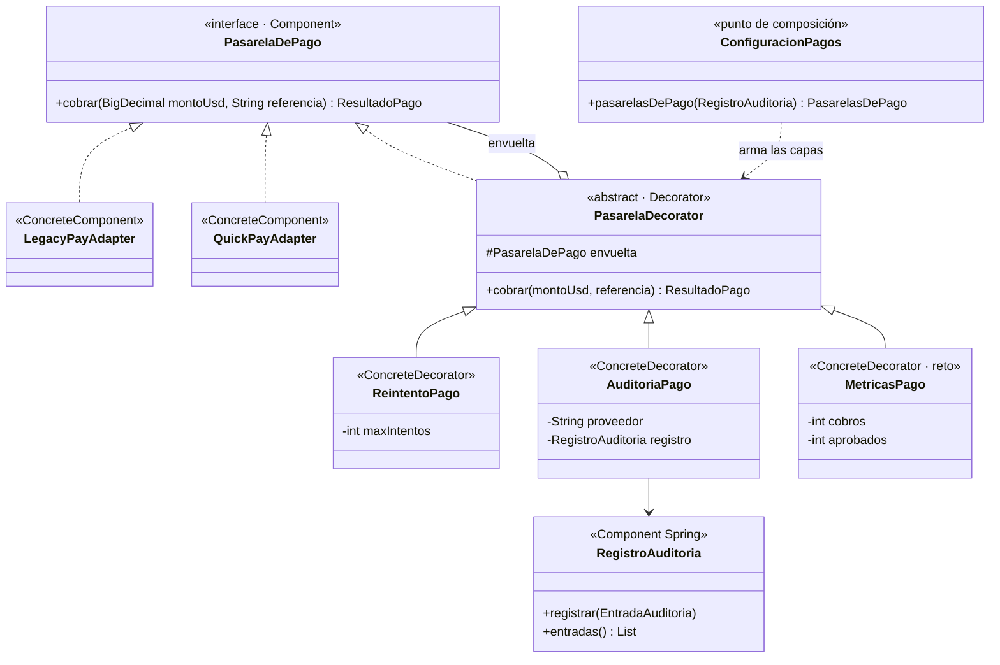

# ShopFlow · taller de patrones de diseño

Ingeniería de Software 2 · Taller: patrones de diseño creacionales y estructurales en una API REST.

## 1. Integrantes, roles y ejecución

| Integrante | Rol | Patrones | Reto de extensión |
|---|---|---|---|
| Ricardo | A | Builder · Abstract Factory | Perú (`FabricaPeru`) |
| _(pendiente)_ | B | Adapter · Decorator | Métricas (`MetricasPago`) |
| _(pendiente)_ | C | Proxy · Factory Method | WhatsApp (`NotificadorWhatsApp`) |

Requisitos: Java 17 o superior y Maven (o un IDE con soporte para Maven).

```bash
mvn spring-boot:run   # la API queda en http://localhost:8080
mvn test              # pruebas unitarias JUnit 5
```

### Qué trae el proyecto base
| Paquete | Contenido | ¿Se modifica? |
|---|---|---|
| `externos.legacypay`, `externos.quickpay` | SDK simulados de los proveedores de pago | **No** |
| `catalogo.CatalogoRemoto` | Catálogo de otro equipo (1,5 s por llamada) | **No** |
| `catalogo.ServicioCatalogo`, `Producto` | Interfaz del catálogo y producto | Provisto |
| `pagos.PasarelaDePago`, `ResultadoPago`, `PasarelaNoDisponibleException` | Interfaz destino y tipos propios de ShopFlow | Provisto |
| `pedidos.PedidoRequest` | JSON de entrada de `POST /api/pedidos` | Provisto |
| `notificaciones.BandejaNotificaciones` | Simula el envío de notificaciones | Provisto |
| `comun.ManejadorErrores` | Excepciones → códigos HTTP | Provisto |

## 2. Tabla de análisis de patrones (Anexo D)

| Patrón | Problema en ShopFlow (síntoma) | Participantes GoF → clases | Principio SOLID | Cuándo no usarlo |
|---|---|---|---|---|
| Factory Method | _(Rol C)_ | | | |
| Abstract Factory | Cada país exige una familia de piezas que deben ir juntas (impuesto, documento del cliente, comprobante). Sin el patrón, un `if (pais.equals("CO"))` se repite en varias clases, es fácil mezclar el IVA de un país con el comprobante de otro y abrir Perú obliga a editar cada `if`. | **AbstractFactory:** `FabricaFacturacion` · **ConcreteFactory:** `FabricaColombia`, `FabricaMexico`, `FabricaPeru` · **AbstractProduct:** `CalculadoraImpuestos`, `ValidadorIdentificacion`, `GeneradorComprobante` · **ConcreteProduct:** `IvaColombia`, `ValidadorCedulaNit`, `GeneradorFacturaDian` (y sus equivalentes de MX y PE) · **Client:** `ServicioFacturacion` | **OCP:** un país nuevo es una fábrica nueva. **DIP:** `ServicioFacturacion` depende de interfaces, nunca de clases de un país. | Cuando no hay familias (un solo producto), o cuando la familia cambia de forma con frecuencia: agregar un producto nuevo obliga a modificar la interfaz y todas las fábricas concretas. |
| Builder | Un pedido tiene 4 datos obligatorios, al menos un ítem y 6 opciones con reglas cruzadas (dirección obligatoria si no se recoge en tienda, tienda y express incompatibles, nota ≤ 140). Un constructor de 11 parámetros es fácil de llamar con dos `String` invertidos; con setters, el pedido existe a medias y puede quedar inválido. | **Product:** `Pedido` (inmutable) · **Builder:** `Pedido.Builder` (versión de Bloch, sin builder abstracto) · **Director / cliente:** `PedidoService.crear()` · **Parte:** `ItemPedido` | **SRP:** `Pedido` representa el pedido; `Pedido.Builder` se encarga de construirlo y validarlo. | Objetos con 2 o 3 parámetros, todos obligatorios: el builder duplica código sin aportar nada y hay que mantenerlo cada vez que el producto cambia de atributos. |
| Adapter | ShopFlow cobra con LegacyPay (monto en centavos, respuesta de texto `"00\|LP4051"`, su propia `LegacyPayTimeoutException`) y con QuickPay (monto `double`, enum propio). Los SDK no se pueden modificar. Sin el patrón, los centavos, los códigos `"00\|…"` y los enums del proveedor quedan regados por la lógica de negocio, y cambiar de proveedor obliga a reescribirla. | **Target:** `PasarelaDePago` · **Adapter:** `LegacyPayAdapter`, `QuickPayAdapter` · **Adaptee:** `LegacyPayClient`, `QuickPaySdk` (paquete `externos`) · **Client:** `PedidoService` | **DIP:** el dominio depende de `PasarelaDePago`, una abstracción propia, y nunca del SDK. **SRP:** toda la traducción de un proveedor vive en una sola clase. **OCP:** un proveedor nuevo es un adapter nuevo. | Cuando se controlan las dos interfaces: es más simple alinearlas. Y cuando la intención es simplificar un subsistema completo, porque eso es Facade. |
| Decorator | LegacyPay falla por timeout el 30 % de las veces, auditoría exige registrar cada cobro y en pruebas los reintentos deben poder apagarse. Con herencia harían falta `LegacyPayConReintento`, `LegacyPayConAuditoria`, `LegacyPayConReintentoYAuditoria`… por cada proveedor: una explosión de clases. | **Component:** `PasarelaDePago` · **ConcreteComponent:** `LegacyPayAdapter`, `QuickPayAdapter` · **Decorator:** `PasarelaDecorator` · **ConcreteDecorator:** `ReintentoPago`, `AuditoriaPago`, `MetricasPago` (reto) · **Ensamblador:** `ConfiguracionPagos` | **OCP:** una capa nueva es una clase nueva. **SRP:** cada decorador hace una sola cosa. **LSP:** una pasarela decorada se usa donde se espera cualquier `PasarelaDePago`. | Cuando las combinaciones son pocas y fijas (dos subclases bastan), cuando el cliente depende del tipo concreto, o cuando una capa necesita saber qué otras capas hay en la cadena. |
| Proxy | _(Rol C)_ | | | |

## 3. Patrones implementados

### 3.1 Builder: `POST /api/pedidos`

**Problema que resuelve.** Construir un `Pedido` siempre válido sin un constructor gigante ni setters. Todas las reglas que cruzan varias opciones viven en un solo lugar: `Pedido.Builder.build()`.

```mermaid
classDiagram
    class Pedido {
        <<Product>>
        -final String id
        -final String clienteId
        -final String pais
        -final List~ItemPedido~ items
        -final BigDecimal subtotal
        -final BigDecimal descuento
        -final EstadoPedido estado
        -final Comprobante comprobante
        -Pedido(Builder b)
        +conComprobante(Comprobante) Pedido
        +pagado(String autorizacion) Pedido
        +baseGravable() BigDecimal
        +totalAPagar() BigDecimal
    }
    class Builder {
        <<Builder>>
        +Builder(clienteId, documentoCliente, pais, contacto)
        +id(String) Builder
        +item(ItemPedido) Builder
        +direccionEnvio(String) Builder
        +recogerEnTienda(boolean) Builder
        +cupon(String) Builder
        +notaRegalo(String) Builder
        +envioExpress(boolean) Builder
        +canalNotificacion(String) Builder
        +build() Pedido
    }
    class ItemPedido {
        <<record>>
        sku
        nombre
        cantidad
        precioUnitario
    }
    class PedidoService {
        <<Director / Client>>
        +crear(PedidoRequest) Pedido
    }
    Pedido +-- Builder : clase estática anidada
    Builder ..> Pedido : build()
    Pedido o-- ItemPedido
    PedidoService ..> Builder : traduce el JSON a llamadas
```

**Decisiones de diseño**
- `Pedido` no tiene constructor público ni setters. `PedidoBuilderTest.pedidoNoTieneConstructoresPublicosNiSetters` lo verifica por reflexión.
- Cambiar de estado devuelve **una copia**: `conComprobante(...)` y `pagado(...)`. Así el pedido sigue siendo inmutable después de facturarse y pagarse.
- El builder **no valida** el país, el formato del documento ni el canal de notificación. Si lo hiciera contra una lista fija (`CO|MX`, `EMAIL|SMS`), los retos de Perú y WhatsApp obligarían a modificar `Pedido`. Esas reglas las validan la fábrica del país y el notificador del canal.
- El precio de cada `ItemPedido` lo toma `PedidoService` del catálogo, nunca del JSON del cliente.

**Evidencia:** `POST /api/pedidos`. Sin ítems, a domicilio sin dirección, o para recoger en tienda con express, responde 400 con un mensaje distinto en cada caso. Con `BOSQUE10`, el campo `descuento` aparece en la respuesta.

### 3.2 Abstract Factory: comprobante en `POST /api/pedidos`

**Problema que resuelve.** Garantizar que el impuesto, el validador de documento y el comprobante de un pedido pertenezcan **al mismo país**, sin ningún `if` ni `switch` por país.


| País | Impuesto | Documento del cliente | Comprobante |
|---|---|---|---|
| CO | IVA 19 % | Cédula o NIT, 6 a 10 dígitos | Factura electrónica (DIAN), `FE-CO-n` |
| MX | IVA 16 % | RFC (ej. `GODE561231GR8`) | CFDI (SAT), `CFDI-MX-n` |
| PE | IGV 18 % | RUC, 11 dígitos | Factura electrónica (SUNAT), `FE-PE-n` |

**Decisiones de diseño**
- Spring inyecta en `ServicioFacturacion` **todas** las fábricas anotadas con `@Component` como `List<FabricaFacturacion>`, y el servicio arma un mapa por `pais()`. Un país sin fábrica responde 400 con la lista de países disponibles: es un `Optional.orElseThrow`, no un `if` por país.
- Cada país vive en su propio subpaquete (`facturacion.colombia`, `facturacion.mexico`, `facturacion.peru`), y sus productos concretos son *package-private*. Ninguna clase fuera de ese paquete puede ni siquiera nombrarlos.
- El consecutivo del comprobante vive en cada fábrica (`AtomicInteger`), porque `crearGenerador()` entrega un objeto nuevo en cada llamada.
- Los montos usan `BigDecimal` con `RoundingMode.HALF_UP` a 2 decimales. En el ejemplo B.2, la base es 122.40 y el IVA de 19 % da 23.26, con total 145.66.

**Evidencia:** escenarios 3 y 5 del Anexo B. `ServicioFacturacionTest.pedidoDeMexicoConCedulaColombianaEsRechazado` demuestra que las piezas de una familia no se mezclan.

### 3.3 Adapter: `POST /api/pedidos/{id}/pago`

**Problema que resuelve.** Hacer que dos SDK ajenos e incompatibles entre sí se vean como una sola interfaz de ShopFlow, `PasarelaDePago.cobrar(BigDecimal montoUsd, String referencia)`. Así el dominio nunca ve centavos, códigos de texto, enums ni excepciones del proveedor.



| Traducción | LegacyPayAdapter | QuickPayAdapter |
|---|---|---|
| Monto | `BigDecimal` USD → `long` centavos (`HALF_UP`) | `BigDecimal` → `double` |
| Respuesta | `"00\|LP…"` → aprobado · `"51\|"` → «Fondos insuficientes» · otro código → «Transacción no permitida» | `OK` → aprobado · `REJECTED` / `ERROR` → rechazado |
| Error | `LegacyPayTimeoutException` → `PasarelaNoDisponibleException` (503) | — |

**Decisiones de diseño**
- Son adaptadores **de objeto** (composición), no de clase. Cada uno tiene dos constructores: uno recibe el SDK (para las pruebas, con `new LegacyPayClient(0.0)` o `(1.0)`) y otro lo crea por dentro. Así `ConfiguracionPagos` no importa nada de `externos`. Solo los dos adapters lo importan, y se verifica con `grep -rl "shopflow.externos" src/main/java`.
- `PedidoService.pagar()` cobra `pedido.totalAPagar()`. Si la pasarela rechaza, lanza `IllegalStateException` con el mensaje del rechazo (409). Si aprueba, guarda `pedido.pagado(autorizacion)`.
- Un pedido ya pagado responde 409 **antes** de llamar a la pasarela, para no cobrarle dos veces al cliente. El cobro ocurre dentro de `ConcurrentHashMap.compute()`, que bloquea ese pedido mientras se cobra. Dos pagos simultáneos del mismo pedido no generan dos cobros.
- Las pasarelas armadas llegan a `PedidoService` dentro de `PasarelasDePago`, una clase propia y no un `Map<String, PasarelaDePago>` suelto. Si Spring ve un `Map<String, X>` en un constructor, lo llena con todos los beans de tipo `X`. Un proveedor desconocido responde 400.

**Evidencia:** escenarios 6 y 7 del Anexo B. Pagar dos veces da 409. Dos portátiles (3.451 USD) con LegacyPay dan 409 «Fondos insuficientes», y el mismo pedido con QuickPay da 200. Con `--shopflow.pagos.reintentos=false --shopflow.legacypay.probabilidad-timeout=1.0`, el pago con LegacyPay responde 503 y no 500. Pruebas: `LegacyPayAdapterTest`, `QuickPayAdapterTest` y `PedidoServicePagoTest`.

### 3.4 Decorator: `GET /api/pagos/auditoria`

**Problema que resuelve.** Agregar reintentos, auditoría (y en el reto, métricas) a cualquier pasarela sin crear una subclase por combinación. Las capas se activan o se apagan desde `application.properties`.



Cadena que arma `ConfiguracionPagos` para cada proveedor (de afuera hacia adentro):

```
AuditoriaPago → MetricasPago → ReintentoPago → LegacyPayAdapter / QuickPayAdapter
```

| Propiedad | Efecto |
|---|---|
| `shopflow.pagos.reintentos=true` | Agrega `ReintentoPago` con `shopflow.pagos.max-intentos` intentos |
| `shopflow.pagos.auditoria=true` | Agrega `AuditoriaPago`, por fuera del reintento |
| `shopflow.pagos.metricas` (opcional, `true` por defecto) | Agrega `MetricasPago` (reto B) |

**Decisiones de diseño**
- `PasarelaDecorator` **es** una `PasarelaDePago` y **tiene** una `PasarelaDePago`, a la que delega por defecto. Cada decorador concreto sobrescribe `cobrar()` y llama a `super.cobrar(...)`.
- `ReintentoPago` reintenta solo cuando recibe `PasarelaNoDisponibleException`. Un rechazo («Fondos insuficientes») es una respuesta válida del proveedor y no se reintenta. Si se agotan los intentos, propaga la última excepción (503).
- `AuditoriaPago` registra también los cobros que terminan en excepción (`"ERROR: …"`) y luego deja pasar la excepción. Así auditoría tiene **todos** los cobros, incluidos los que fallaron.
- La auditoría va **por fuera** del reintento, así queda una entrada por cobro y no una por intento. `AuditoriaPagoTest` prueba los dos órdenes.
- `ConfiguracionPagos` es el único lugar que conoce los adapters y decoradores concretos. Cambiar las propiedades cambia las capas sin modificar ninguna clase.

**Evidencia:** escenario 8 del Anexo B (`GET /api/pagos/auditoria`). Cada entrada trae `proveedor`, `referencia`, `montoUsd`, `resultado` y `duracionMs`. Pruebas: `ReintentoPagoTest` y `AuditoriaPagoTest`.
### 3.5 Proxy: _(Rol C)_
### 3.6 Factory Method: _(Rol C)_

## 4. Retos de extensión

### Reto A: Perú (Abstract Factory)

**Qué se pidió.** Agregar `FabricaPeru` (IGV del 18 %, RUC de 11 dígitos y "Factura electrónica (SUNAT)"), de modo que un pedido con `"pais": "PE"` se facture correctamente **sin modificar ninguna clase existente**.

**Archivos del reto (todos nuevos):**
```
src/main/java/co/edu/unbosque/shopflow/facturacion/peru/FabricaPeru.java
src/main/java/co/edu/unbosque/shopflow/facturacion/peru/IgvPeru.java
src/main/java/co/edu/unbosque/shopflow/facturacion/peru/ValidadorRuc.java
src/main/java/co/edu/unbosque/shopflow/facturacion/peru/GeneradorFacturaSunat.java
src/test/java/co/edu/unbosque/shopflow/facturacion/peru/FabricaPeruTest.java
```

**Por qué no hubo que tocar nada:** `FabricaPeru` es un `@Component` que implementa `FabricaFacturacion`. Spring la agrega a la `List<FabricaFacturacion>` que recibe `ServicioFacturacion`, y ella aparece sola en el mapa con la clave `PE`. `Pedido.Builder` tampoco cambia, porque nunca validó contra una lista fija de países.

**Evidencia:** `evidencias/reto-a-git-diff-stat.txt` _(pegar aquí la salida de `git diff --stat` del commit del reto)_.

### Reto B: Métricas: _(Rol B)_
### Reto C: WhatsApp: _(Rol C)_

## 5. Preguntas de reflexión

_(pendiente: responder en grupo)_

## 6. Conclusiones y dificultades

_(pendiente: responder en grupo)_
