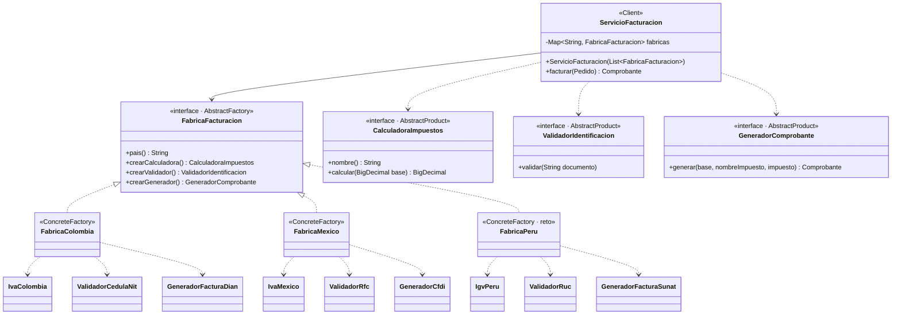
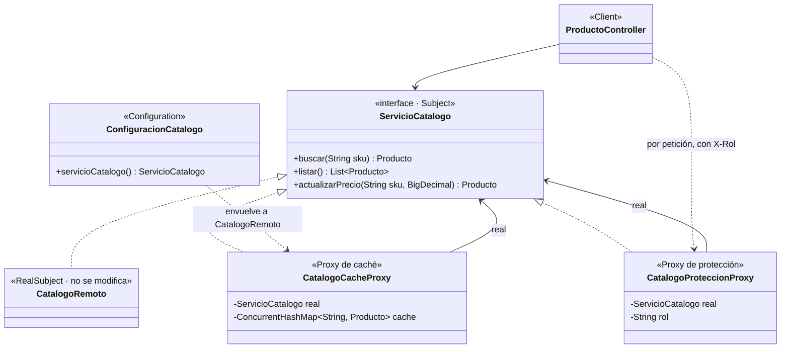
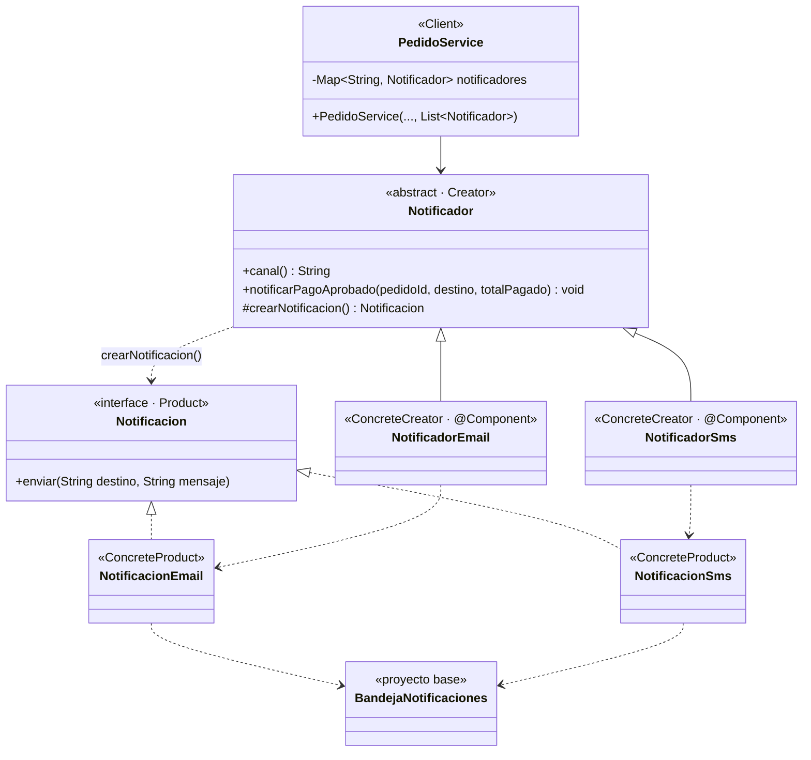

# ShopFlow · taller de patrones de diseño

Ingeniería de Software 2 · Taller: patrones de diseño creacionales y estructurales en una API REST.

## 1. Integrantes, roles y ejecución

| Integrante | Rol | Patrones | Reto de extensión |
|---|---|---|---|
| Ricardo | A | Builder · Abstract Factory | Perú (`FabricaPeru`) |
| _(pendiente)_ | B | Adapter · Decorator | Métricas (`MetricasPago`) |
| _(pendiente)_ | C | Proxy · Factory Method | WhatsApp (`NotificadorWhatsApp`) |

Requisitos: Java 17 o superior y Maven (o un IDE con soporte para Maven).

```bash
mvn spring-boot:run   # la API queda en http://localhost:8080
mvn test              # pruebas unitarias JUnit 5
```

### Qué trae el proyecto base
| Paquete | Contenido | ¿Se modifica? |
|---|---|---|
| `externos.legacypay`, `externos.quickpay` | SDK simulados de los proveedores de pago | **No** |
| `catalogo.CatalogoRemoto` | Catálogo de otro equipo (1,5 s por llamada) | **No** |
| `catalogo.ServicioCatalogo`, `Producto` | Interfaz del catálogo y producto | Provisto |
| `pagos.PasarelaDePago`, `ResultadoPago`, `PasarelaNoDisponibleException` | Interfaz destino y tipos propios de ShopFlow | Provisto |
| `pedidos.PedidoRequest` | JSON de entrada de `POST /api/pedidos` | Provisto |
| `notificaciones.BandejaNotificaciones` | Simula el envío de notificaciones | Provisto |
| `comun.ManejadorErrores` | Excepciones → códigos HTTP | Provisto |

## 2. Tabla de análisis de patrones (Anexo D)

| Patrón | Problema en ShopFlow (síntoma) | Participantes GoF → clases | Principio SOLID | Cuándo no usarlo |
|---|---|---|---|---|
| Factory Method | Al aprobarse un pago hay que notificar por el canal que eligió el cliente. Sin el patrón, `PedidoService` hace `new NotificacionEmail()` o `new NotificacionSms()` según un `if`, y cada canal nuevo (WhatsApp) obliga a modificarlo. | **Product:** `Notificacion` · **ConcreteProduct:** `NotificacionEmail`, `NotificacionSms` · **Creator:** `Notificador` (`notificarPagoAprobado()` final + método fábrica `crearNotificacion()`) · **ConcreteCreator:** `NotificadorEmail`, `NotificadorSms` · **Client:** `PedidoService` | **OCP:** un canal nuevo es una subclase nueva. **DIP:** `PedidoService` depende de `Notificador`, no de un canal concreto. **SRP:** la creación de cada notificación queda aislada en su creador. | Cuando hay un solo canal que no cambia: una jerarquía de creadores es más compleja que el `new` que reemplaza. Conviene empezar con un `new` y pasar al patrón cuando el condicional que elige la clase empiece a crecer. |
| Abstract Factory | Cada país exige una familia de piezas que deben ir juntas (impuesto, documento del cliente, comprobante). Sin el patrón, un `if (pais.equals("CO"))` se repite en varias clases, es fácil mezclar el IVA de un país con el comprobante de otro y abrir Perú obliga a editar cada `if`. | **AbstractFactory:** `FabricaFacturacion` · **ConcreteFactory:** `FabricaColombia`, `FabricaMexico`, `FabricaPeru` · **AbstractProduct:** `CalculadoraImpuestos`, `ValidadorIdentificacion`, `GeneradorComprobante` · **ConcreteProduct:** `IvaColombia`, `ValidadorCedulaNit`, `GeneradorFacturaDian` (y sus equivalentes de MX y PE) · **Client:** `ServicioFacturacion` | **OCP:** un país nuevo es una fábrica nueva. **DIP:** `ServicioFacturacion` depende de interfaces, nunca de clases de un país. | Cuando no hay familias (un solo producto), o cuando la familia cambia de forma con frecuencia: agregar un producto nuevo obliga a modificar la interfaz y todas las fábricas concretas. |
| Builder | Un pedido tiene 4 datos obligatorios, al menos un ítem y 6 opciones con reglas cruzadas (dirección obligatoria si no se recoge en tienda, tienda y express incompatibles, nota ≤ 140). Un constructor de 11 parámetros es fácil de llamar con dos `String` invertidos; con setters, el pedido existe a medias y puede quedar inválido. | **Product:** `Pedido` (inmutable) · **Builder:** `Pedido.Builder` (versión de Bloch, sin builder abstracto) · **Director / cliente:** `PedidoService.crear()` · **Parte:** `ItemPedido` | **SRP:** `Pedido` representa el pedido; `Pedido.Builder` se encarga de construirlo y validarlo. | Objetos con 2 o 3 parámetros, todos obligatorios: el builder duplica código sin aportar nada y hay que mantenerlo cada vez que el producto cambia de atributos. |
| Adapter | _(Rol B)_ | | | |
| Decorator | _(Rol B)_ | | | |
| Proxy | El catálogo es de otro equipo y tarda 1,5 s por consulta: un pedido de tres productos tarda 4,5 s solo en precios. Además, solo un ADMIN puede cambiar precios, y sin el patrón ese control se copia en cada lugar que cambia un precio. | **Subject:** `ServicioCatalogo` · **RealSubject:** `CatalogoRemoto` · **Proxy (caché):** `CatalogoCacheProxy` · **Proxy (protección):** `CatalogoProteccionProxy` · **Client:** `ProductoController`, `PedidoService` · **Composición:** `ConfiguracionCatalogo` | **OCP:** la caché y el control de acceso se agregan sin tocar `CatalogoRemoto`. **DIP:** los clientes reciben un `ServicioCatalogo` y no saben si hablan con el real o con un proxy. **SRP:** cada proxy tiene una sola responsabilidad. | Cuando el objeto real es barato y local: el proxy agrega una capa y, en el caso de la caché, el riesgo de servir datos viejos sin ganar nada. |

## 3. Patrones implementados

### 3.1 Builder: `POST /api/pedidos`

**Problema que resuelve.** Construir un `Pedido` siempre válido sin un constructor gigante ni setters. Todas las reglas que cruzan varias opciones viven en un solo lugar: `Pedido.Builder.build()`.

```mermaid
classDiagram
    class Pedido {
        <<Product>>
        -final String id
        -final String clienteId
        -final String pais
        -final List~ItemPedido~ items
        -final BigDecimal subtotal
        -final BigDecimal descuento
        -final EstadoPedido estado
        -final Comprobante comprobante
        -Pedido(Builder b)
        +conComprobante(Comprobante) Pedido
        +pagado(String autorizacion) Pedido
        +baseGravable() BigDecimal
        +totalAPagar() BigDecimal
    }
    class Builder {
        <<Builder>>
        +Builder(clienteId, documentoCliente, pais, contacto)
        +id(String) Builder
        +item(ItemPedido) Builder
        +direccionEnvio(String) Builder
        +recogerEnTienda(boolean) Builder
        +cupon(String) Builder
        +notaRegalo(String) Builder
        +envioExpress(boolean) Builder
        +canalNotificacion(String) Builder
        +build() Pedido
    }
    class ItemPedido {
        <<record>>
        sku
        nombre
        cantidad
        precioUnitario
    }
    class PedidoService {
        <<Director / Client>>
        +crear(PedidoRequest) Pedido
    }
    Pedido +-- Builder : clase estática anidada
    Builder ..> Pedido : build()
    Pedido o-- ItemPedido
    PedidoService ..> Builder : traduce el JSON a llamadas
```

**Decisiones de diseño**
- `Pedido` no tiene constructor público ni setters. `PedidoBuilderTest.pedidoNoTieneConstructoresPublicosNiSetters` lo verifica por reflexión.
- Cambiar de estado devuelve **una copia**: `conComprobante(...)` y `pagado(...)`. Así el pedido sigue siendo inmutable después de facturarse y pagarse.
- El builder **no valida** el país, el formato del documento ni el canal de notificación. Si lo hiciera contra una lista fija (`CO|MX`, `EMAIL|SMS`), los retos de Perú y WhatsApp obligarían a modificar `Pedido`. Esas reglas las validan la fábrica del país y el notificador del canal.
- El precio de cada `ItemPedido` lo toma `PedidoService` del catálogo, nunca del JSON del cliente.

**Evidencia:** `POST /api/pedidos`. Sin ítems, a domicilio sin dirección, o para recoger en tienda con express, responde 400 con un mensaje distinto en cada caso. Con `BOSQUE10`, el campo `descuento` aparece en la respuesta.

### 3.2 Abstract Factory: comprobante en `POST /api/pedidos`

**Problema que resuelve.** Garantizar que el impuesto, el validador de documento y el comprobante de un pedido pertenezcan **al mismo país**, sin ningún `if` ni `switch` por país.



| País | Impuesto | Documento del cliente | Comprobante |
|---|---|---|---|
| CO | IVA 19 % | Cédula o NIT, 6 a 10 dígitos | Factura electrónica (DIAN), `FE-CO-n` |
| MX | IVA 16 % | RFC (ej. `GODE561231GR8`) | CFDI (SAT), `CFDI-MX-n` |
| PE | IGV 18 % | RUC, 11 dígitos | Factura electrónica (SUNAT), `FE-PE-n` |

**Decisiones de diseño**
- Spring inyecta en `ServicioFacturacion` **todas** las fábricas anotadas con `@Component` como `List<FabricaFacturacion>`, y el servicio arma un mapa por `pais()`. Un país sin fábrica responde 400 con la lista de países disponibles: es un `Optional.orElseThrow`, no un `if` por país.
- Cada país vive en su propio subpaquete (`facturacion.colombia`, `facturacion.mexico`, `facturacion.peru`), y sus productos concretos son *package-private*. Ninguna clase fuera de ese paquete puede ni siquiera nombrarlos.
- El consecutivo del comprobante vive en cada fábrica (`AtomicInteger`), porque `crearGenerador()` entrega un objeto nuevo en cada llamada.
- Los montos usan `BigDecimal` con `RoundingMode.HALF_UP` a 2 decimales. En el ejemplo B.2, la base es 122.40 y el IVA de 19 % da 23.26, con total 145.66.

**Evidencia:** escenarios 3 y 5 del Anexo B. `ServicioFacturacionTest.pedidoDeMexicoConCedulaColombianaEsRechazado` demuestra que las piezas de una familia no se mezclan.

### 3.3 Adapter: _(Rol B)_
### 3.4 Decorator: _(Rol B)_
### 3.5 Proxy: `GET /api/productos/{sku}` y `PUT /api/productos/{sku}/precio`

**Problema que resuelve.** Evitar los 1,5 s de `CatalogoRemoto` en cada consulta repetida y restringir el cambio de precios al rol ADMIN, sin que ningún cliente del catálogo sepa si habla con el objeto real o con un intermediario.



**Decisiones de diseño**
- `ConfiguracionCatalogo` es el **único** lugar que sabe que existe el proxy de caché: registra `new CatalogoCacheProxy(new CatalogoRemoto())` como el `ServicioCatalogo` de toda la aplicación. `PedidoService` y `ProductoController` reciben la interfaz.
- La caché usa `computeIfAbsent`: solo llama al catálogo real si el SKU no está en memoria. Si el real lanza `NoSuchElementException`, no se guarda nada y la API responde 404.
- Al cambiar un precio, el proxy de caché delega al real y **reemplaza** la entrada de su caché, para no servir un precio viejo.
- El proxy de protección se crea **por petición** en `ProductoController`, porque el rol (encabezado `X-Rol`) cambia en cada una. Las consultas pasan directo; `actualizarPrecio` lanza `AccesoDenegadoException` (403) si el rol no es ADMIN.

**Evidencia:** `evidencias/escenario-1.txt` (primera consulta de SKU-003 ≈ 1,5 s; la segunda < 0,05 s) y `evidencias/escenario-2.txt` (403 con `X-Rol: CLIENTE`, 200 con `X-Rol: ADMIN` y precio nuevo en la consulta siguiente). `CatalogoCacheProxyTest` demuestra con un catálogo falso que cuenta llamadas que dos búsquedas llegan una sola vez al real.

### 3.6 Factory Method: `GET /api/notificaciones`

**Problema que resuelve.** Notificar el pago aprobado por el canal del pedido con un proceso fijo (armar el mensaje, crear la notificación y enviarla), dejando que cada canal decida **qué** notificación crea. `PedidoService` no tiene ningún `new Notificacion...` ni un `if` por canal.



| Canal | Producto | Regla propia |
|---|---|---|
| `EMAIL` | `NotificacionEmail` | El contacto debe tener «@» (si no, 400); el mensaje lleva el asunto `[Pago aprobado]`. |
| `SMS` | `NotificacionSms` | El mensaje se recorta a 160 caracteres. |

**Decisiones de diseño**
- `notificarPagoAprobado(...)` es `final`: el proceso no lo puede alterar ninguna subclase. Lo único que varía es el método fábrica `protected abstract Notificacion crearNotificacion()`.
- Spring inyecta en `PedidoService` **todos** los `Notificador` anotados con `@Component` como `List<Notificador>`, y el servicio arma un mapa por `canal()`, igual que `ServicioFacturacion` con las fábricas de país.
- Un canal no soportado responde 400 **al crear el pedido**, con la lista de canales disponibles. Es un `Optional.orElseThrow` sobre el mapa, no un `if` por canal. `Pedido.Builder` solo pasa el canal a mayúsculas: no lo valida contra una lista fija, así el reto de WhatsApp no toca `Pedido`.
- El canal es opcional (Anexo B.2): un pedido sin canal se crea igual y no se notifica.
- Los productos concretos (`NotificacionEmail`, `NotificacionSms`) son *package-private*: fuera de `notificaciones` nadie puede nombrarlos.
- Los notificadores reciben primitivas (`pedidoId`, `destino`, `totalPagado`) y no el `Pedido`, para que el paquete `notificaciones` no dependa de `pedidos`.
- **Integración con el Rol B:** `PedidoService.notificarPagoAprobado(Pedido pagado)` usa el contacto del pedido y su total pagado (`totalAPagar()`). El método `pagar()` del Rol B debe llamarlo después de `pedido.pagado(...)` cuando el resultado del pago sea aprobado.

**Evidencia:** escenario 8 del Anexo B (`GET /api/notificaciones`, una notificación por pago aprobado, en el canal del pedido). `NotificadorEmailTest.unContactoSinArrobaEsRechazado` demuestra que cada creador concreto produce su propio producto con sus reglas; `NotificadorSmsTest` y `PedidoServiceNotificacionTest` cubren el recorte del SMS, el 400 por canal no soportado y la notificación con el total pagado.

## 4. Retos de extensión

### Reto A: Perú (Abstract Factory)

**Qué se pidió.** Agregar `FabricaPeru` (IGV del 18 %, RUC de 11 dígitos y "Factura electrónica (SUNAT)"), de modo que un pedido con `"pais": "PE"` se facture correctamente **sin modificar ninguna clase existente**.

**Archivos del reto (todos nuevos):**
```
src/main/java/co/edu/unbosque/shopflow/facturacion/peru/FabricaPeru.java
src/main/java/co/edu/unbosque/shopflow/facturacion/peru/IgvPeru.java
src/main/java/co/edu/unbosque/shopflow/facturacion/peru/ValidadorRuc.java
src/main/java/co/edu/unbosque/shopflow/facturacion/peru/GeneradorFacturaSunat.java
src/test/java/co/edu/unbosque/shopflow/facturacion/peru/FabricaPeruTest.java
```

**Por qué no hubo que tocar nada:** `FabricaPeru` es un `@Component` que implementa `FabricaFacturacion`. Spring la agrega a la `List<FabricaFacturacion>` que recibe `ServicioFacturacion`, y ella aparece sola en el mapa con la clave `PE`. `Pedido.Builder` tampoco cambia, porque nunca validó contra una lista fija de países.

**Evidencia:** `evidencias/reto-a-git-diff-stat.txt` _(pegar aquí la salida de `git diff --stat` del commit del reto)_.

### Reto B: Métricas: _(Rol B)_
### Reto C: WhatsApp: _(Rol C)_

## 5. Preguntas de reflexión

_(pendiente: responder en grupo)_

## 6. Conclusiones y dificultades

_(pendiente: responder en grupo)_
