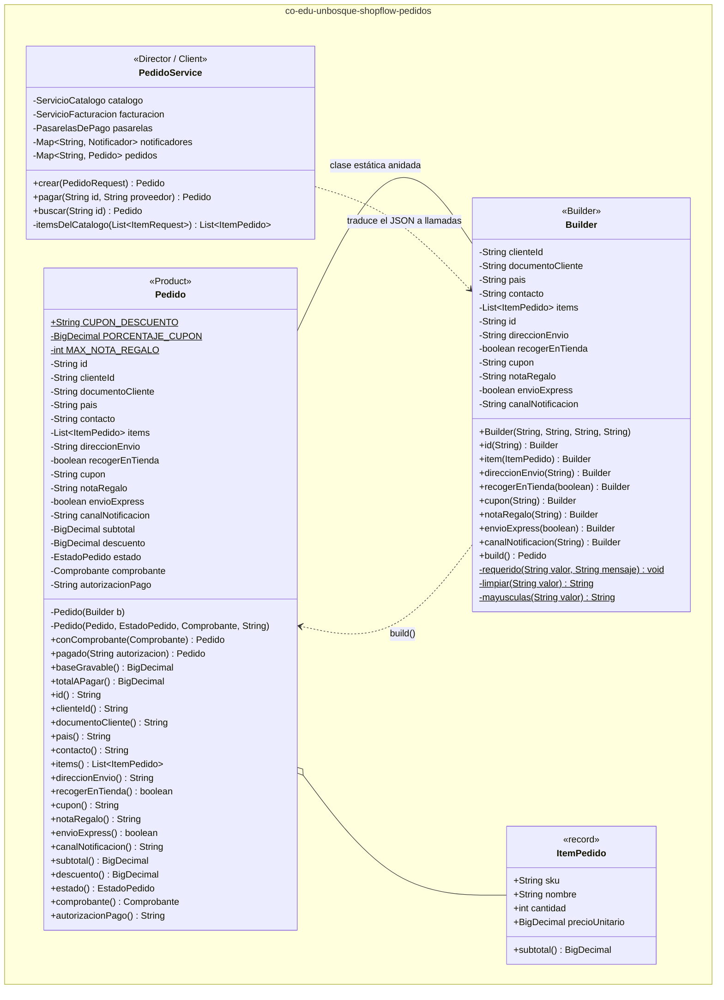
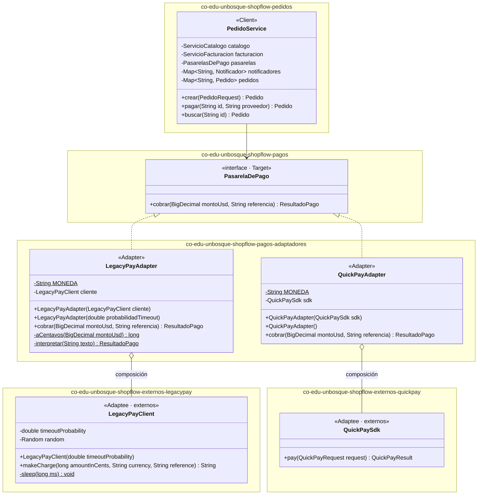
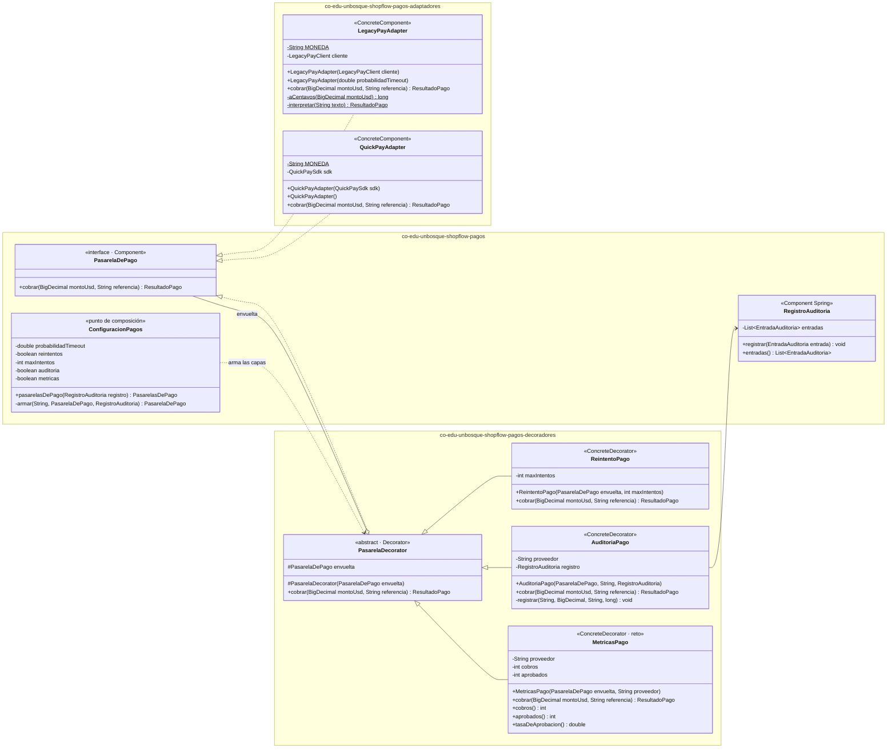
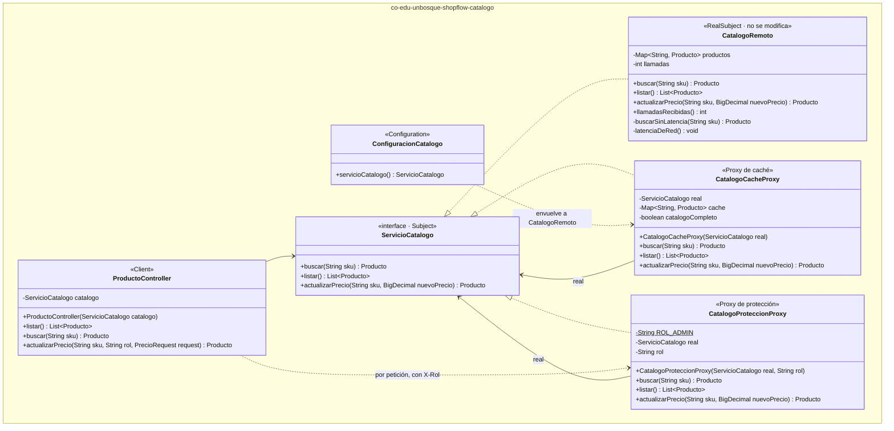
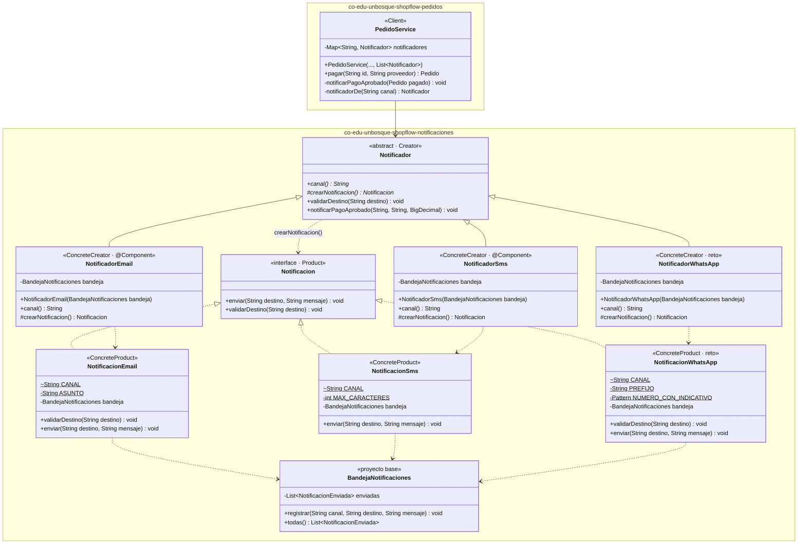

# ShopFlow · taller de patrones de diseño

Ingeniería de Software 2 · Taller: patrones de diseño creacionales y estructurales en una API REST.

## 1. Integrantes, roles y ejecución

| Integrante | Rol | Patrones | Reto de extensión |
|---|---|---|---|
| Ricardo | A | Builder · Abstract Factory | Perú (`FabricaPeru`) |
| _Samuel_ | B | Adapter · Decorator | Métricas (`MetricasPago`) |
| Nicolás | C | Proxy · Factory Method | WhatsApp (`NotificadorWhatsApp`) |

Requisitos: Java 17 o superior y Maven (o un IDE con soporte para Maven).

```bash
mvn spring-boot:run   # la API queda en http://localhost:8080
mvn test              # pruebas unitarias JUnit 5
```

### Qué trae el proyecto base
| Paquete | Contenido | ¿Se modifica? |
|---|---|---|
| `externos.legacypay`, `externos.quickpay` | SDK simulados de los proveedores de pago | **No** |
| `catalogo.CatalogoRemoto` | Catálogo de otro equipo (1,5 s por llamada) | **No** |
| `catalogo.ServicioCatalogo`, `Producto` | Interfaz del catálogo y producto | Provisto |
| `pagos.PasarelaDePago`, `ResultadoPago`, `PasarelaNoDisponibleException` | Interfaz destino y tipos propios de ShopFlow | Provisto |
| `pedidos.PedidoRequest` | JSON de entrada de `POST /api/pedidos` | Provisto |
| `notificaciones.BandejaNotificaciones` | Simula el envío de notificaciones | Provisto |
| `comun.ManejadorErrores` | Excepciones → códigos HTTP | Provisto |

## 2. Tabla de análisis de patrones (Anexo D)

| Patrón | Problema en ShopFlow (síntoma) | Participantes GoF → clases | Principio SOLID | Cuándo no usarlo |
|---|---|---|---|---|
| Factory Method | Al aprobarse un pago hay que notificar por el canal que eligió el cliente. Sin el patrón, `PedidoService` hace `new NotificacionEmail()` o `new NotificacionSms()` según un `if`, y cada canal nuevo (WhatsApp) obliga a modificarlo. | **Product:** `Notificacion` · **ConcreteProduct:** `NotificacionEmail`, `NotificacionSms`, `NotificacionWhatsApp` (reto) · **Creator:** `Notificador` (`notificarPagoAprobado()` final + método fábrica `crearNotificacion()`) · **ConcreteCreator:** `NotificadorEmail`, `NotificadorSms`, `NotificadorWhatsApp` (reto) · **Client:** `PedidoService` | **OCP:** un canal nuevo es una subclase nueva. **DIP:** `PedidoService` depende de `Notificador`, no de un canal concreto. **SRP:** la creación de cada notificación queda aislada en su creador. | Cuando hay un solo canal que no cambia: una jerarquía de creadores es más compleja que el `new` que reemplaza. Conviene empezar con un `new` y pasar al patrón cuando el condicional que elige la clase empiece a crecer. |
| Abstract Factory | Cada país exige una familia de piezas que deben ir juntas (impuesto, documento del cliente, comprobante). Sin el patrón, un `if (pais.equals("CO"))` se repite en varias clases, es fácil mezclar el IVA de un país con el comprobante de otro y abrir Perú obliga a editar cada `if`. | **AbstractFactory:** `FabricaFacturacion` · **ConcreteFactory:** `FabricaColombia`, `FabricaMexico`, `FabricaPeru` · **AbstractProduct:** `CalculadoraImpuestos`, `ValidadorIdentificacion`, `GeneradorComprobante` · **ConcreteProduct:** `IvaColombia`, `ValidadorCedulaNit`, `GeneradorFacturaDian` (y sus equivalentes de MX y PE) · **Client:** `ServicioFacturacion` | **OCP:** un país nuevo es una fábrica nueva. **DIP:** `ServicioFacturacion` depende de interfaces, nunca de clases de un país. | Cuando no hay familias (un solo producto), o cuando la familia cambia de forma con frecuencia: agregar un producto nuevo obliga a modificar la interfaz y todas las fábricas concretas. |
| Builder | Un pedido tiene 4 datos obligatorios, al menos un ítem y 6 opciones con reglas cruzadas (dirección obligatoria si no se recoge en tienda, tienda y express incompatibles, nota ≤ 140). Un constructor de 11 parámetros es fácil de llamar con dos `String` invertidos; con setters, el pedido existe a medias y puede quedar inválido. | **Product:** `Pedido` (inmutable) · **Builder:** `Pedido.Builder` (versión de Bloch, sin builder abstracto) · **Director / cliente:** `PedidoService.crear()` · **Parte:** `ItemPedido` | **SRP:** `Pedido` representa el pedido; `Pedido.Builder` se encarga de construirlo y validarlo. | Objetos con 2 o 3 parámetros, todos obligatorios: el builder duplica código sin aportar nada y hay que mantenerlo cada vez que el producto cambia de atributos. |
| Adapter | ShopFlow cobra con LegacyPay (monto en centavos, respuesta de texto `"00\|LP4051"`, su propia `LegacyPayTimeoutException`) y con QuickPay (monto `double`, enum propio). Los SDK no se pueden modificar. Sin el patrón, los centavos, los códigos `"00\|…"` y los enums del proveedor quedan regados por la lógica de negocio, y cambiar de proveedor obliga a reescribirla. | **Target:** `PasarelaDePago` · **Adapter:** `LegacyPayAdapter`, `QuickPayAdapter` · **Adaptee:** `LegacyPayClient`, `QuickPaySdk` (paquete `externos`) · **Client:** `PedidoService` | **DIP:** el dominio depende de `PasarelaDePago`, una abstracción propia, y nunca del SDK. **SRP:** toda la traducción de un proveedor vive en una sola clase. **OCP:** un proveedor nuevo es un adapter nuevo. | Cuando se controlan las dos interfaces: es más simple alinearlas. Y cuando la intención es simplificar un subsistema completo, porque eso es Facade. |
| Decorator | LegacyPay falla por timeout el 30 % de las veces, auditoría exige registrar cada cobro y en pruebas los reintentos deben poder apagarse. Con herencia harían falta `LegacyPayConReintento`, `LegacyPayConAuditoria`, `LegacyPayConReintentoYAuditoria`… por cada proveedor: una explosión de clases. | **Component:** `PasarelaDePago` · **ConcreteComponent:** `LegacyPayAdapter`, `QuickPayAdapter` · **Decorator:** `PasarelaDecorator` · **ConcreteDecorator:** `ReintentoPago`, `AuditoriaPago`, `MetricasPago` (reto) · **Ensamblador:** `ConfiguracionPagos` | **OCP:** una capa nueva es una clase nueva. **SRP:** cada decorador hace una sola cosa. **LSP:** una pasarela decorada se usa donde se espera cualquier `PasarelaDePago`. | Cuando las combinaciones son pocas y fijas (dos subclases bastan), cuando el cliente depende del tipo concreto, o cuando una capa necesita saber qué otras capas hay en la cadena. |
| Proxy | El catálogo es de otro equipo y tarda 1,5 s por consulta: un pedido de tres productos tarda 4,5 s solo en precios. Además, solo un ADMIN puede cambiar precios, y sin el patrón ese control se copia en cada lugar que cambia un precio. | **Subject:** `ServicioCatalogo` · **RealSubject:** `CatalogoRemoto` · **Proxy (caché):** `CatalogoCacheProxy` · **Proxy (protección):** `CatalogoProteccionProxy` · **Client:** `ProductoController`, `PedidoService` · **Composición:** `ConfiguracionCatalogo` | **OCP:** la caché y el control de acceso se agregan sin tocar `CatalogoRemoto`. **DIP:** los clientes reciben un `ServicioCatalogo` y no saben si hablan con el real o con un proxy. **SRP:** cada proxy tiene una sola responsabilidad. | Cuando el objeto real es barato y local: el proxy agrega una capa y, en el caso de la caché, el riesgo de servir datos viejos sin ganar nada. |

## 3. Patrones implementados

### 3.1 Builder: `POST /api/pedidos`

**Problema que resuelve.** Construir un `Pedido` siempre válido sin un constructor gigante ni setters. Todas las reglas que cruzan varias opciones viven en un solo lugar: `Pedido.Builder.build()`.



**Decisiones de diseño**
- `Pedido` no tiene constructor público ni setters. `PedidoBuilderTest.pedidoNoTieneConstructoresPublicosNiSetters` lo verifica por reflexión.
- Cambiar de estado devuelve **una copia**: `conComprobante(...)` y `pagado(...)`. Así el pedido sigue siendo inmutable después de facturarse y pagarse.
- El builder **no valida** el país, el formato del documento ni el canal de notificación. Si lo hiciera contra una lista fija (`CO|MX`, `EMAIL|SMS`), los retos de Perú y WhatsApp obligarían a modificar `Pedido`. Esas reglas las validan la fábrica del país y el notificador del canal.
- El precio de cada `ItemPedido` lo toma `PedidoService` del catálogo, nunca del JSON del cliente.

**Evidencia:** `POST /api/pedidos`. Sin ítems, a domicilio sin dirección, o para recoger en tienda con express, responde 400 con un mensaje distinto en cada caso. Con `BOSQUE10`, el campo `descuento` aparece en la respuesta.

### 3.2 Abstract Factory: comprobante en `POST /api/pedidos`

**Problema que resuelve.** Garantizar que el impuesto, el validador de documento y el comprobante de un pedido pertenezcan **al mismo país**, sin ningún `if` ni `switch` por país.

```mermaid
classDiagram
    namespace co-edu-unbosque-shopflow-facturacion {
        class FabricaFacturacion {
            <<interface · AbstractFactory>>
            +pais() String
            +crearCalculadora() CalculadoraImpuestos
            +crearValidador() ValidadorIdentificacion
            +crearGenerador() GeneradorComprobante
        }
        class CalculadoraImpuestos {
            <<interface · AbstractProduct>>
            +nombre() String
            +calcular(BigDecimal base) BigDecimal
        }
        class ValidadorIdentificacion {
            <<interface · AbstractProduct>>
            +validar(String documento) void
        }
        class GeneradorComprobante {
            <<interface · AbstractProduct>>
            +generar(BigDecimal, String, BigDecimal) Comprobante
        }
        class ServicioFacturacion {
            <<Client>>
            -Map~String, FabricaFacturacion~ fabricas
            +ServicioFacturacion(List~FabricaFacturacion~)
            +facturar(Pedido) Comprobante
            -fabricaDe(String pais) FabricaFacturacion
        }
    }
    namespace co-edu-unbosque-shopflow-facturacion-colombia {
        class FabricaColombia {
            <<ConcreteFactory>>
            -AtomicInteger consecutivo
            +pais() String
            +crearCalculadora() CalculadoraImpuestos
            +crearValidador() ValidadorIdentificacion
            +crearGenerador() GeneradorComprobante
        }
        class IvaColombia {
            <<ConcreteProduct>>
            -BigDecimal TARIFA$
            +nombre() String
            +calcular(BigDecimal base) BigDecimal
        }
        class ValidadorCedulaNit {
            <<ConcreteProduct>>
            +validar(String documento) void
        }
        class GeneradorFacturaDian {
            <<ConcreteProduct>>
            -AtomicInteger consecutivo
            +generar(BigDecimal, String, BigDecimal) Comprobante
        }
    }
    namespace co-edu-unbosque-shopflow-facturacion-mexico {
        class FabricaMexico {
            <<ConcreteFactory>>
            -AtomicInteger consecutivo
            +pais() String
            +crearCalculadora() CalculadoraImpuestos
            +crearValidador() ValidadorIdentificacion
            +crearGenerador() GeneradorComprobante
        }
        class IvaMexico {
            <<ConcreteProduct>>
            -BigDecimal TARIFA$
            +nombre() String
            +calcular(BigDecimal base) BigDecimal
        }
        class ValidadorRfc {
            <<ConcreteProduct>>
            +validar(String documento) void
        }
        class GeneradorCfdi {
            <<ConcreteProduct>>
            -AtomicInteger consecutivo
            +generar(BigDecimal, String, BigDecimal) Comprobante
        }
    }
    namespace co-edu-unbosque-shopflow-facturacion-peru {
        class FabricaPeru {
            <<ConcreteFactory · reto>>
            -AtomicInteger consecutivo
            +pais() String
            +crearCalculadora() CalculadoraImpuestos
            +crearValidador() ValidadorIdentificacion
            +crearGenerador() GeneradorComprobante
        }
        class IgvPeru {
            <<ConcreteProduct · reto>>
            -BigDecimal TARIFA$
            +nombre() String
            +calcular(BigDecimal base) BigDecimal
        }
        class ValidadorRuc {
            <<ConcreteProduct · reto>>
            +validar(String documento) void
        }
        class GeneradorFacturaSunat {
            <<ConcreteProduct · reto>>
            -AtomicInteger consecutivo
            +generar(BigDecimal, String, BigDecimal) Comprobante
        }
    }

    FabricaFacturacion <|.. FabricaColombia
    FabricaFacturacion <|.. FabricaMexico
    FabricaFacturacion <|.. FabricaPeru
    ServicioFacturacion --> FabricaFacturacion
    ServicioFacturacion ..> CalculadoraImpuestos
    ServicioFacturacion ..> ValidadorIdentificacion
    ServicioFacturacion ..> GeneradorComprobante

    CalculadoraImpuestos <|.. IvaColombia
    CalculadoraImpuestos <|.. IvaMexico
    CalculadoraImpuestos <|.. IgvPeru
    ValidadorIdentificacion <|.. ValidadorCedulaNit
    ValidadorIdentificacion <|.. ValidadorRfc
    ValidadorIdentificacion <|.. ValidadorRuc
    GeneradorComprobante <|.. GeneradorFacturaDian
    GeneradorComprobante <|.. GeneradorCfdi
    GeneradorComprobante <|.. GeneradorFacturaSunat

    FabricaColombia ..> IvaColombia
    FabricaColombia ..> ValidadorCedulaNit
    FabricaColombia ..> GeneradorFacturaDian
    FabricaMexico ..> IvaMexico
    FabricaMexico ..> ValidadorRfc
    FabricaMexico ..> GeneradorCfdi
    FabricaPeru ..> IgvPeru
    FabricaPeru ..> ValidadorRuc
    FabricaPeru ..> GeneradorFacturaSunat
```



| País | Impuesto | Documento del cliente | Comprobante |
|---|---|---|---|
| CO | IVA 19 % | Cédula o NIT, 6 a 10 dígitos | Factura electrónica (DIAN), `FE-CO-n` |
| MX | IVA 16 % | RFC (ej. `GODE561231GR8`) | CFDI (SAT), `CFDI-MX-n` |
| PE | IGV 18 % | RUC, 11 dígitos | Factura electrónica (SUNAT), `FE-PE-n` |

**Decisiones de diseño**
- Spring inyecta en `ServicioFacturacion` **todas** las fábricas anotadas con `@Component` como `List<FabricaFacturacion>`, y el servicio arma un mapa por `pais()`. Un país sin fábrica responde 400 con la lista de países disponibles: es un `Optional.orElseThrow`, no un `if` por país.
- Cada país vive en su propio subpaquete (`facturacion.colombia`, `facturacion.mexico`, `facturacion.peru`), y sus productos concretos son *package-private*. Ninguna clase fuera de ese paquete puede ni siquiera nombrarlos.
- El consecutivo del comprobante vive en cada fábrica (`AtomicInteger`), porque `crearGenerador()` entrega un objeto nuevo en cada llamada.
- Los montos usan `BigDecimal` con `RoundingMode.HALF_UP` a 2 decimales. En el ejemplo B.2, la base es 122.40 y el IVA de 19 % da 23.26, con total 145.66.

**Evidencia:** escenarios 3 y 5 del Anexo B. `ServicioFacturacionTest.pedidoDeMexicoConCedulaColombianaEsRechazado` demuestra que las piezas de una familia no se mezclan.

### 3.3 Adapter: `POST /api/pedidos/{id}/pago`

**Problema que resuelve.** Hacer que dos SDK ajenos e incompatibles entre sí se vean como una sola interfaz de ShopFlow, `PasarelaDePago.cobrar(BigDecimal montoUsd, String referencia)`. Así el dominio nunca ve centavos, códigos de texto, enums ni excepciones del proveedor.



| Traducción | LegacyPayAdapter | QuickPayAdapter |
|---|---|---|
| Monto | `BigDecimal` USD → `long` centavos (`HALF_UP`) | `BigDecimal` → `double` |
| Respuesta | `"00\|LP…"` → aprobado · `"51\|"` → «Fondos insuficientes» · otro código → «Transacción no permitida» | `OK` → aprobado · `REJECTED` / `ERROR` → rechazado |
| Error | `LegacyPayTimeoutException` → `PasarelaNoDisponibleException` (503) | — |

**Decisiones de diseño**
- Son adaptadores **de objeto** (composición), no de clase. Cada uno tiene dos constructores: uno recibe el SDK (para las pruebas, con `new LegacyPayClient(0.0)` o `(1.0)`) y otro lo crea por dentro. Así `ConfiguracionPagos` no importa nada de `externos`. Solo los dos adapters lo importan, y se verifica con `grep -rl "shopflow.externos" src/main/java`.
- `PedidoService.pagar()` cobra `pedido.totalAPagar()`. Si la pasarela rechaza, lanza `IllegalStateException` con el mensaje del rechazo (409). Si aprueba, guarda `pedido.pagado(autorizacion)`.
- Un pedido ya pagado responde 409 **antes** de llamar a la pasarela, para no cobrarle dos veces al cliente. El cobro ocurre dentro de `ConcurrentHashMap.compute()`, que bloquea ese pedido mientras se cobra. Dos pagos simultáneos del mismo pedido no generan dos cobros.
- Las pasarelas armadas llegan a `PedidoService` dentro de `PasarelasDePago`, una clase propia y no un `Map<String, PasarelaDePago>` suelto. Si Spring ve un `Map<String, X>` en un constructor, lo llena con todos los beans de tipo `X`. Un proveedor desconocido responde 400.

**Evidencia:** escenarios 6 y 7 del Anexo B. Pagar dos veces da 409. Dos portátiles (3.451 USD) con LegacyPay dan 409 «Fondos insuficientes», y el mismo pedido con QuickPay da 200. Con `--shopflow.pagos.reintentos=false --shopflow.legacypay.probabilidad-timeout=1.0`, el pago con LegacyPay responde 503 y no 500. Pruebas: `LegacyPayAdapterTest`, `QuickPayAdapterTest` y `PedidoServicePagoTest`.

### 3.4 Decorator: `GET /api/pagos/auditoria`

**Problema que resuelve.** Agregar reintentos, auditoría (y en el reto, métricas) a cualquier pasarela sin crear una subclase por combinación. Las capas se activan o se apagan desde `application.properties`.



Cadena que arma `ConfiguracionPagos` para cada proveedor (de afuera hacia adentro):

```
AuditoriaPago → MetricasPago → ReintentoPago → LegacyPayAdapter / QuickPayAdapter
```

| Propiedad | Efecto |
|---|---|
| `shopflow.pagos.reintentos=true` | Agrega `ReintentoPago` con `shopflow.pagos.max-intentos` intentos |
| `shopflow.pagos.auditoria=true` | Agrega `AuditoriaPago`, por fuera del reintento |
| `shopflow.pagos.metricas` (opcional, `true` por defecto) | Agrega `MetricasPago` (reto B) |

**Decisiones de diseño**
- `PasarelaDecorator` **es** una `PasarelaDePago` y **tiene** una `PasarelaDePago`, a la que delega por defecto. Cada decorador concreto sobrescribe `cobrar()` y llama a `super.cobrar(...)`.
- `ReintentoPago` reintenta solo cuando recibe `PasarelaNoDisponibleException`. Un rechazo («Fondos insuficientes») es una respuesta válida del proveedor y no se reintenta. Si se agotan los intentos, propaga la última excepción (503).
- `AuditoriaPago` registra también los cobros que terminan en excepción (`"ERROR: …"`) y luego deja pasar la excepción. Así auditoría tiene **todos** los cobros, incluidos los que fallaron.
- La auditoría va **por fuera** del reintento, así queda una entrada por cobro y no una por intento. `AuditoriaPagoTest` prueba los dos órdenes.
- `ConfiguracionPagos` es el único lugar que conoce los adapters y decoradores concretos. Cambiar las propiedades cambia las capas sin modificar ninguna clase.

**Evidencia:** escenario 8 del Anexo B (`GET /api/pagos/auditoria`). Cada entrada trae `proveedor`, `referencia`, `montoUsd`, `resultado` y `duracionMs`. Pruebas: `ReintentoPagoTest` y `AuditoriaPagoTest`.

### 3.5 Proxy: `GET /api/productos/{sku}` y `PUT /api/productos/{sku}/precio`

**Problema que resuelve.** Evitar los 1,5 s de `CatalogoRemoto` en cada consulta repetida y restringir el cambio de precios al rol ADMIN, sin que ningún cliente del catálogo sepa si habla con el objeto real o con un intermediario.



**Decisiones de diseño**
- `ConfiguracionCatalogo` es el **único** lugar que sabe que existe el proxy de caché: registra `new CatalogoCacheProxy(new CatalogoRemoto())` como el `ServicioCatalogo` de toda la aplicación. `PedidoService` y `ProductoController` reciben la interfaz.
- La caché usa `computeIfAbsent`: solo llama al catálogo real si el SKU no está en memoria. Si el real lanza `NoSuchElementException`, no se guarda nada y la API responde 404.
- Al cambiar un precio, el proxy de caché delega al real y **reemplaza** la entrada de su caché, para no servir un precio viejo.
- El proxy de protección se crea **por petición** en `ProductoController`, porque el rol (encabezado `X-Rol`) cambia en cada una. Las consultas pasan directo; `actualizarPrecio` lanza `AccesoDenegadoException` (403) si el rol no es ADMIN.

**Evidencia:** `evidencias/escenario-1.txt` (primera consulta de SKU-003 ≈ 1,5 s; la segunda < 0,05 s) y `evidencias/escenario-2.txt` (403 con `X-Rol: CLIENTE`, 200 con `X-Rol: ADMIN` y precio nuevo en la consulta siguiente). `CatalogoCacheProxyTest` demuestra con un catálogo falso que cuenta llamadas que dos búsquedas llegan una sola vez al real.

### 3.6 Factory Method: `GET /api/notificaciones`

**Problema que resuelve.** Notificar el pago aprobado por el canal del pedido con un proceso fijo (armar el mensaje, crear la notificación y enviarla), dejando que cada canal decida **qué** notificación crea. `PedidoService` no tiene ningún `new Notificacion...` ni un `if` por canal.



| Canal | Producto | Regla propia |
|---|---|---|
| `EMAIL` | `NotificacionEmail` | El contacto debe tener «@» (si no, 400); el mensaje lleva el asunto `[Pago aprobado]`. |
| `SMS` | `NotificacionSms` | El mensaje se recorta a 160 caracteres. |
| `WHATSAPP` (reto C) | `NotificacionWhatsApp` | El contacto debe ser un número con indicativo, ej. `+573001234567` (si no, 400); el mensaje empieza con «✅». |

**Decisiones de diseño**
- `notificarPagoAprobado(...)` es `final`: el proceso no lo puede alterar ninguna subclase. Lo único que varía es el método fábrica `protected abstract Notificacion crearNotificacion()`.
- Spring inyecta en `PedidoService` **todos** los `Notificador` anotados con `@Component` como `List<Notificador>`, y el servicio arma un mapa por `canal()`, igual que `ServicioFacturacion` con las fábricas de país.
- Un canal no soportado responde 400 **al crear el pedido**, con la lista de canales disponibles. Es un `Optional.orElseThrow` sobre el mapa, no un `if` por canal. `Pedido.Builder` solo pasa el canal a mayúsculas: no lo valida contra una lista fija, así el reto de WhatsApp no toca `Pedido`.
- El contacto se valida **al crear el pedido** con `Notificador.validarDestino(...)`, que delega en el mismo producto que luego se envía (`Notificacion.validarDestino`). Así un pedido EMAIL con un teléfono como contacto responde 400 antes de cobrar, y no después de un pago aprobado.
- El canal es opcional (Anexo B.2): un pedido sin canal se crea igual y no se notifica.
- Los productos concretos (`NotificacionEmail`, `NotificacionSms`) son *package-private*: fuera de `notificaciones` nadie puede nombrarlos.
- Los notificadores reciben primitivas (`pedidoId`, `destino`, `totalPagado`) y no el `Pedido`, para que el paquete `notificaciones` no dependa de `pedidos`.
- **Integración con el pago (Rol B):** `PedidoService.pagar()` notifica **después** de que `compute()` guarda el pedido como pagado, fuera del bloqueo y solo si el pago fue aprobado. Usa el contacto del pedido y su total pagado (`totalAPagar()`). Un pago rechazado (409) no notifica.

**Evidencia:** escenario 8 del Anexo B (`GET /api/notificaciones`, una notificación por pago aprobado, en el canal del pedido). `NotificadorEmailTest.unContactoSinArrobaEsRechazado` demuestra que cada creador concreto produce su propio producto con sus reglas; `NotificadorSmsTest` y `PedidoServiceNotificacionTest` cubren el recorte del SMS, el 400 por canal no soportado, la notificación con el total pagado tras `pagar()` y que un pago rechazado no notifica.

## 4. Retos de extensión

### Reto A: Perú (Abstract Factory)

**Qué se pidió.** Agregar `FabricaPeru` (IGV del 18 %, RUC de 11 dígitos y "Factura electrónica (SUNAT)"), de modo que un pedido con `"pais": "PE"` se facture correctamente **sin modificar ninguna clase existente**.

**Archivos del reto (todos nuevos):**
```
src/main/java/co/edu/unbosque/shopflow/facturacion/peru/FabricaPeru.java
src/main/java/co/edu/unbosque/shopflow/facturacion/peru/IgvPeru.java
src/main/java/co/edu/unbosque/shopflow/facturacion/peru/ValidadorRuc.java
src/main/java/co/edu/unbosque/shopflow/facturacion/peru/GeneradorFacturaSunat.java
src/test/java/co/edu/unbosque/shopflow/facturacion/peru/FabricaPeruTest.java
```

**Por qué no hubo que tocar nada:** `FabricaPeru` es un `@Component` que implementa `FabricaFacturacion`. Spring la agrega a la `List<FabricaFacturacion>` que recibe `ServicioFacturacion`, y ella aparece sola en el mapa con la clave `PE`. `Pedido.Builder` tampoco cambia, porque nunca validó contra una lista fija de países.

**Evidencia:** `evidencias/reto-a-git-diff-stat.txt` _(pegar aquí la salida de `git diff --stat` del commit del reto)_.


### Reto B: Métricas (Decorator)

**Qué se pidió.** Agregar el decorador `MetricasPago`, que cuenta los cobros y los aprobados de cada pasarela y escribe en consola la tasa de aprobación después de cada cobro. Solo se puede modificar `ConfiguracionPagos`, para agregar la capa.

**Archivos del reto:**
```
src/main/java/co/edu/unbosque/shopflow/pagos/decoradores/MetricasPago.java          (nuevo)
src/test/java/co/edu/unbosque/shopflow/pagos/decoradores/MetricasPagoTest.java      (nuevo)
src/main/java/co/edu/unbosque/shopflow/pagos/ConfiguracionPagos.java                (única modificación permitida: +8 líneas)
```

**Cómo se resolvió.**
- `MetricasPago` (decorador concreto) extiende `PasarelaDecorator`. Su `cobrar(...)` delega en la pasarela envuelta y, en un bloque `finally`, suma el cobro, suma el aprobado si el resultado fue aprobado y escribe en consola `Métricas <PROVEEDOR>: aprobados/cobros aprobados (tasa %)`.
- Expone `cobros()`, `aprobados()` y `tasaDeAprobacion()` (de 0 a 100; 0 si todavía no hay cobros). Los métodos son `synchronized` para que dos pagos al mismo tiempo no pierdan un conteo.
- La cadena queda `AuditoriaPago → MetricasPago → ReintentoPago → adapter`. Como las métricas van por fuera del reintento, un cobro que necesitó 3 intentos cuenta como **un** cobro, que es lo que ve el cliente.

**Por qué casi no hubo que tocar nada:**
- `MetricasPago` extiende `PasarelaDecorator`, así que ya es una `PasarelaDePago` y encaja en la cadena sin cambiar las otras capas.
- Un cobro que termina en excepción (por ejemplo, el 503 de LegacyPay) cuenta como cobro no aprobado, y la excepción se sigue propagando igual.

**Evidencia:** `evidencias/reto-b-consola.txt` y `evidencias/reto-b-git-diff-stat.txt`.

### Reto C: WhatsApp (Factory Method)

**Qué se pidió.** Agregar `NotificadorWhatsApp`: exige un número con indicativo (por ejemplo, `+573001234567`) y antepone «✅» al mensaje. Un pedido con `"canalNotificacion": "WHATSAPP"` debe notificarse. **Qué se puede modificar: nada, solo archivos nuevos.**

**Archivos del reto (todos nuevos):**
```
src/main/java/co/edu/unbosque/shopflow/notificaciones/NotificacionWhatsApp.java
src/main/java/co/edu/unbosque/shopflow/notificaciones/NotificadorWhatsApp.java
src/test/java/co/edu/unbosque/shopflow/notificaciones/NotificadorWhatsAppTest.java
src/test/java/co/edu/unbosque/shopflow/pedidos/PedidoServiceWhatsAppTest.java
evidencias/reto-c-whatsapp.txt
```

**Cómo se resolvió.**
- `NotificacionWhatsApp` (producto concreto, *package-private*) implementa `Notificacion`. Sobrescribe `validarDestino(...)` para exigir `+` seguido de 8 a 15 dígitos (formato E.164) y `enviar(...)` registra en `BandejaNotificaciones` el mensaje con «✅ » adelante.
- `NotificadorWhatsApp` (creador concreto, `@Component`) extiende `Notificador`: `canal()` devuelve `WHATSAPP` y `crearNotificacion()` entrega un `NotificacionWhatsApp`. El proceso `notificarPagoAprobado(...)` lo hereda sin cambios.

**Por qué no hubo que tocar nada:**
- Spring encuentra el nuevo `@Component` y lo agrega a la `List<Notificador>` que recibe `PedidoService`, que lo indexa por `canal()`. El canal `WHATSAPP` aparece solo en el mapa (y en el mensaje de error de un canal no soportado: `Canales disponibles: [WHATSAPP, SMS, EMAIL]`).
- `Pedido.Builder` nunca validó el canal contra una lista fija, así que acepta `WHATSAPP` sin cambios.
- La validación del número al **crear** el pedido sale gratis: `PedidoService.crear()` ya llama a `Notificador.validarDestino(...)`, que delega en el producto. Un pedido WhatsApp sin indicativo responde 400 antes de cobrar.

**Evidencia:**
- `evidencias/reto-c-git-diff-stat.txt`: el commit del reto (`97e8b1d`) tiene 5 archivos, todos con estado `A` (agregado), 182 inserciones y 0 eliminaciones.
- `evidencias/reto-c-whatsapp.txt`: pedido con `+573001234567` → 201; pago → 200; `GET /api/notificaciones` → `"✅ ShopFlow: el pago del pedido PED-1 fue aprobado. Total pagado: 30.35 USD."`; pedido WhatsApp con `3001234567` → 400.
- Pruebas: `NotificadorWhatsAppTest` (canal, prefijo «✅», número sin indicativo, correo o letras rechazados) y `PedidoServiceWhatsAppTest` (un pedido WHATSAPP se notifica tras el pago, sin modificar `PedidoService`).


## 5. Preguntas de reflexión

_(pendiente: responder en grupo)_

## 6. Conclusiones y dificultades

_(pendiente: responder en grupo)_
